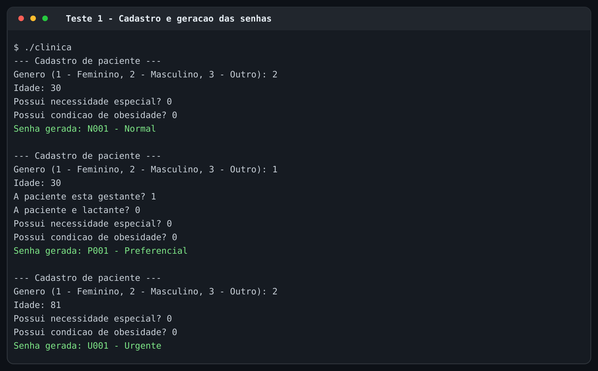
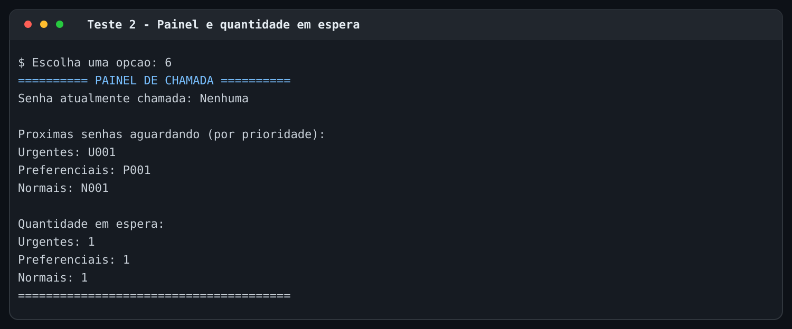
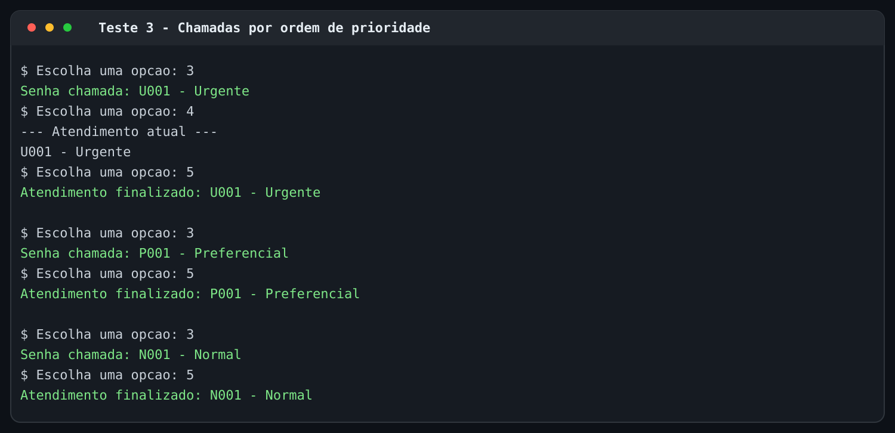

# Sistema de Gerenciamento de Senhas de Atendimento Clínico

## Objetivo

Programa em linguagem C para cadastrar pacientes, gerar senhas por categoria e organizar a chamada dos atendimentos de uma clínica.

## Funcionalidades

- Cadastro de gênero, idade, gestação, lactação, necessidade especial e condição de obesidade.
- Classificação automática em Normal (N), Preferencial (P) ou Urgente (U).
- Numeração independente para cada categoria, como N001, P001 e U001.
- Filas com ordem de chegada dentro de cada categoria.
- Prioridade de chamada: Urgente, Preferencial e Normal.
- Consulta da próxima senha, chamada do paciente e identificação do atendimento atual.
- Finalização do atendimento.
- Painel com a senha chamada, as senhas em espera e a quantidade de pacientes por categoria.

## Regras utilizadas

- Urgente: pacientes com idade superior a 80 anos.
- Preferencial: gestantes, lactantes, pessoas com necessidade especial, pessoas com obesidade, mulheres com 60 anos ou mais e homens com 65 anos ou mais.
- Normal: pacientes que não se enquadram nas condições anteriores.
- A categoria Urgente tem prioridade sobre Preferencial, que tem prioridade sobre Normal.
- Dentro de cada categoria, a ordem de chamada segue a ordem de cadastro (FIFO).

Essas são as regras didáticas definidas no enunciado da atividade.

## Como compilar

É necessário ter um compilador C, como o GCC.

No terminal, dentro da pasta do projeto, execute:

```bash
gcc main.c -o clinica -std=c99 -Wall -Wextra -pedantic
```

## Como executar

No Linux ou macOS:

```bash
./clinica
```

No Windows, após compilar:

```text
clinica.exe
```

## Funções implementadas

- `lerInteiro`: recebe e valida números inteiros.
- `lerSimNao`: recebe respostas de sim ou não.
- `iniciarFila`, `inserirFila`, `retirarFila`, `consultarFila` e `filaVazia`: controlam as filas.
- `classificarPaciente`: define a categoria do paciente.
- `gerarSenha`: gera a numeração da senha.
- `obterFila` e `proximaFila`: selecionam a fila correspondente e a próxima fila a ser atendida.
- `cadastrarPaciente`: registra os dados e emite a senha.
- `consultarProximaSenha`: consulta a próxima senha sem retirá-la da fila.
- `chamarProximoPaciente`: chama o próximo paciente.
- `mostrarAtendimentoAtual`: identifica o atendimento em andamento.
- `finalizarAtendimento`: encerra o atendimento atual.
- `mostrarPainel`: apresenta as filas e as quantidades em espera.
- `inicializarSistema` e `mostrarMenu`: preparam o sistema e exibem as opções.
- `main`: controla o menu e chama as funções do programa.

## Exemplo de utilização

1. Escolha `1 - Cadastrar paciente`.
2. Informe os dados solicitados. Por exemplo, uma pessoa do gênero feminino, com 30 anos, gestante, sem as outras condições, recebe uma senha preferencial, como `P001`.
3. Cadastre outro paciente com mais de 80 anos. Ele recebe uma senha urgente, como `U001`.
4. Escolha `2 - Consultar próxima senha` para verificar quem será chamado.
5. Escolha `3 - Chamar próximo paciente`. A senha urgente será chamada antes da preferencial.
6. Escolha `4` para identificar o atendimento atual e `5` para finalizá-lo.
7. Escolha `6 - Mostrar painel` para consultar as senhas que continuam aguardando.

## Imagens dos testes

As imagens abaixo mostram uma execução de teste com três pacientes: um normal, uma paciente gestante (preferencial) e um paciente com 81 anos (urgente).

### 1. Cadastro e geração das senhas



### 2. Painel de chamada e quantidade em espera



### 3. Chamada e finalização dos atendimentos



Nesse teste, a ordem de chamada observada foi U001, P001 e N001, conforme a prioridade definida para a atividade.

## Limite

O programa armazena até 300 pacientes aguardando em cada categoria durante a execução. Os dados ficam na memória e são apagados quando o programa é encerrado.
